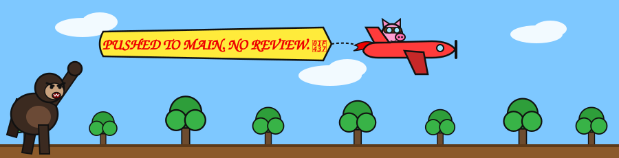

hi

<h1>HI</h1><h2>hi</h2><h3>hi</h3><h4>hi</h4><h5>hi</h5><h6>you're shrinking in my presence, that's normal</h6>

 <h2>the bugs</h2><h3>leaving my codebase</h3><h4>after i open my laptop →</h4>rest in peace. you will not be missed. 

<b>Ｗ Ｅ Ｌ Ｃ Ｏ Ｍ Ｅ　 Ｔ Ｏ　 Ｍ Ｙ　 Ｋ Ｉ Ｎ Ｇ Ｄ Ｏ Ｍ</b>

     <b>🦀 YOUR TECH DEBT IS GONE 🦀</b>

<blockquote><b>you:</b> this bug will take a sprint <b>me:</b> fixed it in my sleep. literally. i woke up and the PR was open.<blockquote><b>you:</b> but how<blockquote><b>me:</b> i looked at it<blockquote><del>your estimate</del> <del>your sprint</del> <del>your job</del> <b>mine now.</b></blockquote></blockquote></blockquote></blockquote>

<h1>my PR getting merged</h1>reviewers: 0 &nbsp;|&nbsp; tests: 0 &nbsp;|&nbsp; bugs: 0 &nbsp;|&nbsp; doubts: 0 

senior devs looking for a flaw in my code: the linter looking for a flaw in my code: the compiler looking for a flaw in my code: (there are none) (there have never been any) 
T̷̢̛̖̓h̸̰̿e̵̝̾ ̶̳̈b̷̧̌u̴̺͝g̶̱̈́s̶̳̈ ̸̬̿f̸̗͂ë̷̙ǎ̴̰r̵̘͠ ̶̲̈́m̸̗̓ē̴̬
<pre>🟩 + works on my machine 🟩 + works on your machine 🟩 + works in prod 🟩 + works on a toaster 🟩 + works on a potato 🟩 + works when the server is unplugged 🟥 - your code</pre>

  left: my team reading my code. right: me watching them read it.
<h6 align="right">things i've said and been 100% right about</h6><ul><li>"it's just a config change"<ul><li>"we don't need tests for this"<ul><li>"trust me bro"<ul><li>"i'll rewrite it in rust over the weekend"<ul><li>"regex is easy actually"<ul><li>"who wrote this masterpiece"<ul><li><i>it was me</i><ul><li><i>it is always me</i><ul><li><b>Ｉ Ｔ　 Ｉ Ｓ　 Ａ Ｌ Ｗ Ａ Ｙ Ｓ　 Ｍ Ｅ</b> 👑</li></ul></li></ul></li></ul></li></ul></li></ul></li></ul></li></ul></li></ul></li></ul>

<h2>QA: "found 1 bug"</h2><h3>me: "no you didn't"</h3><h4>QA: "...you're right"</h4><h5>QA: "sorry for bothering you, king"</h5> 

🎲 facts (100% real, peer reviewed by me, approved by me):<ol><li>my code has no bugs. bugs have me as their final boss.</li><li>i don't debug. the code apologizes and fixes itself.</li><li><code>console.log</code> is for people who don't already know the answer</li><li>stack overflow asks <i>me</i> questions</li><li><code>chmod 777</code> because i trust everyone to bow</li><li>i don't read the docs. the docs read me.</li><li>imposter syndrome? the imposters have <i>me</i> syndrome.</li><li>i once mass-deleted <code>node_modules</code> and the app ran faster out of respect</li><li>i don't need an estimate. it's done. you're welcome.</li><li>there is no 10. 9 was enough.</li></ol>

 <b>me: *opens laptop*</b> <b>the codebase:</b> 

 my commits flying straight to prod. no stops. no reviews. no fear.

<b>contacting me:</b><ol><li>you can't afford my attention</li><li>open an issue</li><li>i already fixed it before you hit submit</li><li>closed as <code>skill issue</code></li><li>you have been added to <code>.gitignore</code></li></ol> 

 <h3>me carrying the entire codebase ↗</h3><h1>ME ↓</h1><h1>👑 SENIOR 👑</h1><h2><del>software</del> engineer of everything</h2> 

<b>🔒 DO NOT OPEN. CONTAINS MY AWS KEYS.</b>
 
 <b>never gonna give you up</b> you really thought i'd leak keys? i don't make mistakes.

click to see my weaknesses 👀
 
 this space intentionally left empty.

 you, realizing you'll never be this good

you may now leave

you may now leave

you may now leave
<h1>YOU MAY NOW LEAVE</h1>
<code>403 Forbidden: insufficient skill ✌️</code>

